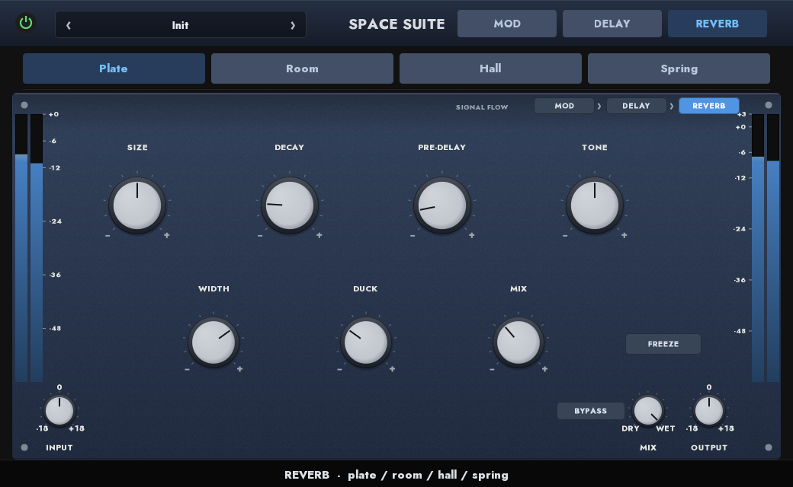
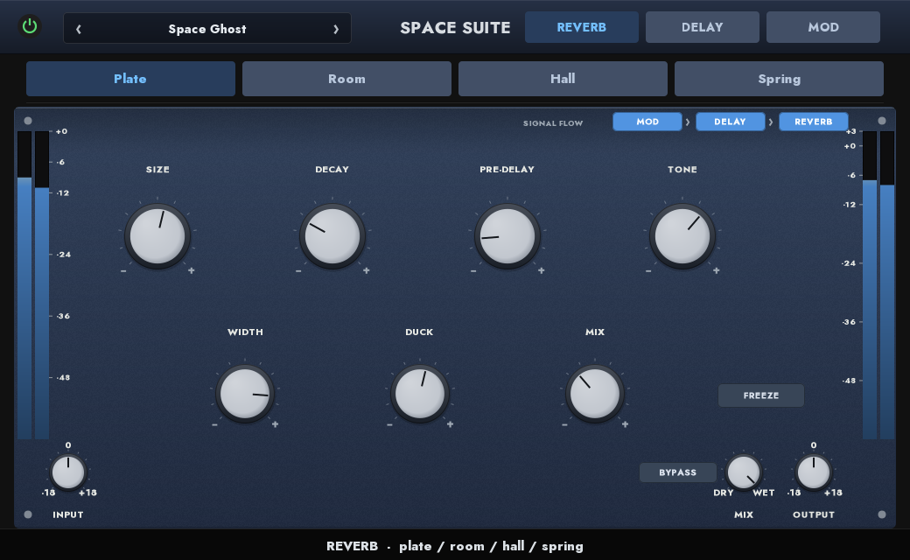

# Space Suite

**Version 0.2.0** · GPL-3.0-or-later

Reverb, delay and modulation in one CLAP + LV2 plugin for Linux. Space Suite
puts the three “time and movement” jobs into one fixed chain, using the same
panel language as Comp Suite and Patina.





## Signal flow

```text
Input trim
  → Modulation (Chorus / Flanger / Phaser / Dimension)
  → Delay (Digital / Tape / Analog / Ping-Pong)
  → Reverb (Plate / Room / Hall / Spring)
  → Output trim → Output
```

Each section has its own `ON` and `MIX`; the page tabs only choose which
controls are on screen. The header chain strip shows the current section
states and lets you switch them directly.

## Pages

### Reverb

- **Plate**, **Room**, **Hall**, **Spring**.
- Size, Decay, Pre-delay, Tone, Width, Duck, Mix.
- **Freeze** holds the tail without a new input.

### Delay

- **Digital**, **Tape**, **Analog**, **Ping-Pong**.
- Tempo divisions (1/1 … 1/32, dotted 1/8) or free time. Sync uses the manual BPM knob in 0.1.0; host tempo sync is planned for 0.2.
- Feedback, Tone, Mod, Width, Duck, Mix.
- The current division or free-time value is shown under the time knob.

### Mod

- **Chorus**, **Flanger**, **Phaser**, **Dimension**.
- Rate, Depth, Feedback, Width, Mix.
- A small animated LFO display shows rate, depth and stereo width.

## Global controls

Input, Output, Mix, Bypass, and the chain enable buttons. The input and output
meters are stereo, with the page accent colour. While a knob is dragged, the
footer shows its exact value.

## Presets

The factory bank covers Plate, Room, Hall, Spring, Delay, Mod, Ambient, Vocal,
Drums and Mix Bus. **Space Ghost** is the mandatory vocal preset: big bright
plate, dotted tape repeat, wide Dimension movement. It does not make you the
actual Space Ghost, but it gets close.

## 0.2.0

- Delay sync follows the host tempo in CLAP and LV2 (`time:Position`), with a
  manual BPM fallback. The BPM control hides when host sync is active.
- Spring reverb gained a dedicated short dispersive allpass tail and stronger
  damping for a more spring-like chirp.
- Fixed LV2 unit metadata (`%`, dB, Hz, ms, BPM).
- User preset saving is planned as the next cross-suite feature.

## Build

Requires CMake 3.16+, a C++17 compiler, Cairo, FreeType, X11 and the LV2
development headers. `lilv` is optional for the LV2 host test.

```sh
git submodule update --init --recursive
cmake -S . -B build -DCMAKE_BUILD_TYPE=Release
cmake --build build -j
ctest --test-dir build --output-on-failure
```

Install for the current user:

```sh
cmake -S . -B build \
  -DCLAP_DIR="$HOME/.clap" \
  -DLV2_DIR="$HOME/.lv2"
cmake --build build -j
cmake --install build
```

`~/.clap` and `~/.lv2` are the per-user plugin directories most hosts scan.

## Status

0.1.0 is the first complete build: three pages, four reverb modes, four delay
modes, four modulation modes, factory presets, LV2 and CLAP, and the Comp Suite
panel chrome. Future work: Spring model refinement, convolution/IR reverb
mode, and user preset saving.

## Licence

GPL-3.0-or-later. The UI skeleton is adapted from Comp Suite; the reverb from
Vocal Suite; the delay from Amp Suite. See `THIRD_PARTY_NOTICES.md`.
